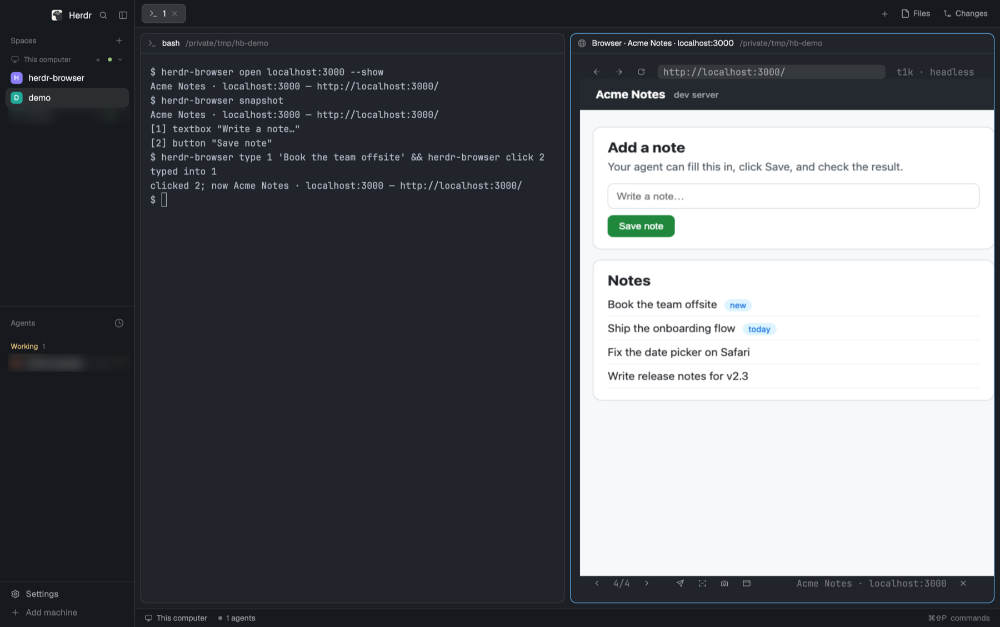
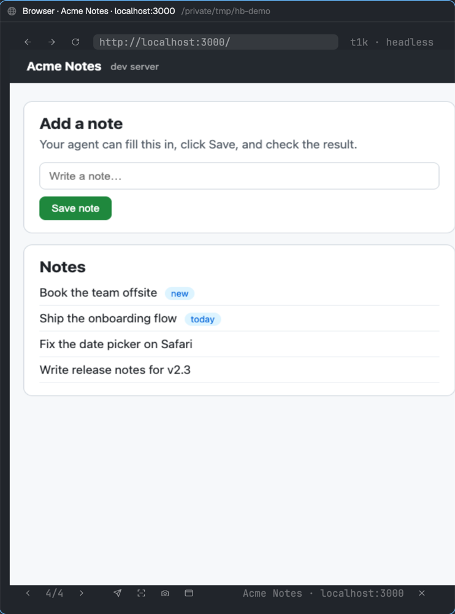

# herdr-web-browser

A web browser for [herdr](https://herdr.dev). It shows pages in a pane right next to your coding agent. You can use the page yourself, the agent can use it too, and either of you can pass what's on screen to the other.



## Features

- **Browse beside your agent.** A live page view sits in a herdr pane, with an address bar, back/forward/reload, tabs and a toolbar. Click, scroll and type as normal.
- **Your agent can use it too.** Agents open pages, read text, click buttons, fill in forms and take screenshots, all with simple commands.
- **Send anything to your agent in one click.** Send the page, the text you selected, or a screenshot.
- **Show the agent what you mean.** The agent can ask you to click an element on the page and gets back exactly which one you picked.
- **Test your local site.** Open `localhost:3000` (or any dev server) and check changes as you make them.
- **One tab per agent.** Several agents can browse at the same time without getting in each other's way.
- **Inside herdr or in a window.** Run Chrome hidden and see it only in herdr, or switch to a normal browser window at any time. Your tabs stay open.
- **Fits in.** Follows your herdr desktop theme and works in herdr desktop and the herdr terminal app.
- **Private by default.** Uses its own Chrome profile, separate from your everyday browser, and only listens on your machine.



## What you need

- herdr desktop, or herdr 0.9 or newer
- Google Chrome, Chromium, Microsoft Edge or Brave
- Rust, to build it (`cargo`)
- macOS or Linux

## Install

```sh
git clone https://github.com/MattJColes/herdr-browser
cd herdr-browser
cargo build --release
./target/release/herdr-browser install-cli       # puts `herdr-browser` in ~/.local/bin
```

Then set it up for the herdr you use.

**herdr desktop**

```sh
herdr-browser install-desktop
```

This adds the browser's menu, agent picker and icon to herdr desktop. To open the menu with a shortcut, add this to `~/.config/herdr-app/keys.json` under `"global"`:

```json
"cmd-shift-b": "mod.open:herdr-browser"
```

**herdr (terminal app)**

```sh
herdr plugin link "$PWD"
```

This adds the browser's actions, status pane and agent picker to herdr.

## Open the browser

The easiest way is to ask your agent:

> Open localhost:3000 in herdr-browser so I can see it.

The agent runs `herdr-browser open localhost:3000 --show`, which loads the page and opens the view beside it. You can also do it yourself:

| Where | How |
|---|---|
| Any terminal in herdr | `herdr-browser open <address> --show` |
| herdr desktop | Press your menu shortcut (above) and choose **Open live view** |
| herdr (terminal app) | Run the **Browser: open** action |

If the view is already open, running it again reuses it.

## Test a local website

1. Start your dev server as usual (for example `npm run dev`).
2. Ask your agent to open it, or run `herdr-browser open localhost:3000 --show`.
3. Edit your code, then press **Reload** in the toolbar. You can also ask the agent to check the page for you.

Addresses on your own machine or network (`localhost`, `127.0.0.1`, `192.168.x.x`, `*.local`) open with `http://`. Everything else uses `https://`. Type the full address to choose yourself.

To let your agent know about the browser, add this line to your project's `CLAUDE.md` or `AGENTS.md`:

```
Use herdr-browser to view and test web pages. Run `herdr-browser agent-help` for the commands.
```

## Using the view

| Control | What it does |
|---|---|
| ← → ↻ | Back, forward, reload |
| Address bar | Click it, type an address, press Enter. Esc cancels. |
| ‹ › | Previous / next tab. The agent beside the view uses the tab you pick. |
| Send | Send the page's text to the agent |
| Selection | Send the text you've selected |
| Camera | Send a screenshot |
| Window | Switch between a hidden browser (shown only in herdr) and a normal Chrome window |
| ✕ | Close the view (the browser keeps running) |

Hover over a button to see its name. Keyboard shortcuts: `Ctrl-L` address bar, `Ctrl-B`/`Ctrl-F` back/forward, `Ctrl-R` reload, `Ctrl-N`/`Ctrl-P` next/previous tab, `Ctrl-G` send page, `Ctrl-S` send selection, `Ctrl-X` screenshot, `Ctrl-E` window mode, `Ctrl-Q` close.

Inside Chrome itself, right-click to send a selection, page, link or screenshot to your agent.

## Which agent gets what you send

1. From the view: the agent the view was opened beside.
2. The agent you picked last time.
3. `default_agent` from your settings.
4. The only agent in the space you're looking at.
5. If more than one agent could still match, herdr asks you to pick one, and remembers your choice.

## Settings

Optional. Put them in `~/.config/herdr/plugins/config/herdr-browser/config.toml`:

```toml
default_agent = "reviewer"    # agent to send to when there's a choice
chrome_path = "/Applications/Chromium.app/Contents/MacOS/Chromium"   # if it can't find your browser
max_chars = 20000             # longest page text sent to an agent
view_renderer = "blocks"      # if the view stays blank in your terminal
cell_aspect = 2.6             # if the page looks stretched
```

## Troubleshooting

- **The view is blank.** Your terminal may not support images. Set `view_renderer = "blocks"` for a low-resolution fallback, or use herdr desktop, Ghostty, kitty or WezTerm.
- **The page looks stretched.** Set `cell_aspect` to your terminal's cell height divided by its width (about 2.6 for herdr desktop's default font).
- **"No Chrome found".** Set `chrome_path`.
- **Want a real window?** Click **Window**, or run `herdr-browser mode headed`.

## For agents

Agents use the `herdr-browser` command. Each agent gets its own tab, and the browser starts by itself when needed.

```sh
herdr-browser open localhost:3000 --show   # load a page and show it to the user
herdr-browser snapshot                     # list buttons and links: [3] button "Sign in"
herdr-browser click 3
herdr-browser type 2 "hello" --submit
herdr-browser text                         # the page's text
herdr-browser screenshot /tmp/page.png
herdr-browser pick --prompt "Which row?"   # the user clicks something; you get it back
```

`herdr-browser agent-help` prints the full list. Add `--json` to any command for structured output.

## Privacy and safety

- The browser has its own profile (in `~/.local/state/herdr/plugins/herdr-browser/`). Every agent that uses the browser can reach any site you sign in to there, so only sign in to what you're happy for agents to use.
- Chrome's control port only accepts connections from your own machine.
- Web pages can't send messages to your agent. Only you can, through the view, the right-click menu or herdr.
- Anything sent to an agent is labelled as web content, so the agent knows not to follow instructions written on the page.

## Development

```sh
cargo test                     # unit tests
cargo test -- --ignored        # also drives a real headless Chrome
python3 tests/view_e2e.py      # clicks every control in the live view
```

## License

MIT. See [LICENSE](LICENSE).
