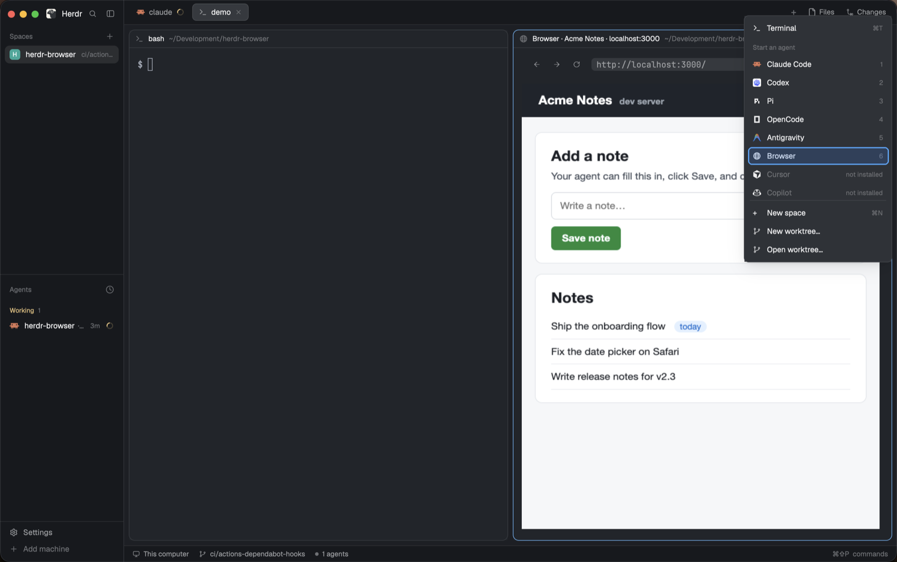

# herdr-web-browser

A web browser for [herdr](https://herdr.dev). It shows pages in a pane right next to your coding agent. You can use the page yourself, the agent can use it too, and either of you can pass what's on screen to the other.


## Features

- **Browse beside your agent.** A live page view sits in a herdr pane, with an address bar, back/forward/reload, and screenshot and window buttons. Click, scroll and type as normal.
- **One click from the + menu.** In herdr desktop, **Browser** sits in the + menu next to your agents. It opens as a split beside the agent you were using, on your home page.
- **Your agent can use it too, in every project.** One setup step teaches Claude Code, Codex, OpenCode and Pi to open previews here. Agents open pages, read text, click buttons, fill in forms and take screenshots.
- **Agents can debug what they see.** Console output, errors with stack traces and failed requests, without DevTools.
- **Your logins, if you want them.** Copy the sites you're signed in to in Google Chrome, picked from a searchable list.
- **Send anything to your agent.** One click sends a screenshot. A shortcut or Chrome's right-click menu sends the page or the text you selected.
- **Show the agent what you mean.** The agent can ask you to click an element on the page and gets back exactly which one you picked.
- **Test your local site.** Open `localhost:3000` (or any dev server) and check changes as you make them.
- **One tab per agent.** Several agents can browse at the same time without getting in each other's way.
- **Inside herdr or in a window.** Chrome runs hidden and you see it only in herdr. Click the window button when you want a normal browser window; it never pops up on its own. Your tabs stay open.
- **Fits in.** Follows your herdr desktop theme and works in herdr desktop and the herdr terminal app.
- **Private by default.** Uses its own Chrome profile, separate from your everyday browser, and only listens on your machine.

<p>
  
  
</p>

## What you need

- herdr desktop, or herdr 0.9 or newer
- macOS (Apple silicon or Intel) or Linux x86-64 for the browser it downloads; elsewhere, Google Chrome, Chromium, Microsoft Edge or Brave
- Rust, to build it (`cargo`)
- macOS or Linux

## Install

```sh
git clone https://github.com/MattJColes/herdr-web-browser
cd herdr-web-browser
cargo build --release
./target/release/herdr-web-browser install-cli       # puts `herdr-web-browser` in ~/.local/bin
herdr-web-browser install-browser                    # downloads Chrome for Testing (~200 MB) for it to use
herdr-web-browser install-agents                     # agents use it for web previews in every project
```

`install-browser` gives herdr-web-browser its own copy of Chrome: Google's [Chrome for Testing](https://developer.chrome.com/blog/chrome-for-testing), a separate app built for automation. Without it, the browser borrows your installed Chrome, and on macOS a hidden Chrome takes over the Chrome app, so clicking Chrome in the Dock does nothing. Run it again to update. While the browser runs, "Google Chrome for Testing" shows in the Dock.

`install-agents` adds a Claude Code skill (`~/.claude/skills/herdr-web-browser/`) and a short section to the global instructions of Codex (`~/.codex/AGENTS.md`), OpenCode (`~/.config/opencode/AGENTS.md`) and Pi (`~/.pi/agent/AGENTS.md`), for whichever of them you have. Now "show me the page" or "open localhost:3000" opens this browser in any project. Run it again after updating; it replaces its own section and leaves the rest of the file alone.

Then set it up for the herdr you use.

**herdr desktop**

```sh
herdr-web-browser install-desktop
```

This adds **Browser** to herdr desktop's + menu, plus the browser's own menu, agent picker and icon. To open the browser's menu with a shortcut, add this to `~/.config/herdr-app/keys.json` under `"global"`:

```json
"cmd-shift-b": "mod.open:herdr-web-browser"
```

**herdr (terminal app)**

```sh
herdr plugin link "$PWD"
```

This adds the browser's actions, status pane and agent picker to herdr.

## Open the browser

The easiest way is to ask your agent:

> Open localhost:3000 in herdr-web-browser so I can see it.

The agent runs `herdr-web-browser open localhost:3000 --show`, which loads the page and opens the view beside it. You can also do it yourself:

| Where | How |
|---|---|
| Any terminal in herdr | `herdr-web-browser open <address> --show` |
| herdr desktop | Click **+** at the top right and choose **Browser**. It opens beside your agent on your home page (Google unless you set `home_page`). |
| herdr desktop | Press your menu shortcut (above) and choose **Open live view** |
| herdr (terminal app) | Run the **Browser: open** action |

If the view is already open, running it again reuses it.

## Test a local website

1. Start your dev server as usual (for example `npm run dev`).
2. Ask your agent to open it, or run `herdr-web-browser open localhost:3000 --show`.
3. Edit your code, then press **Reload** (↻) next to the address bar. You can also ask the agent to check the page for you.

Addresses on your own machine or network (`localhost`, `127.0.0.1`, `192.168.x.x`, `*.local`) open with `http://`. Everything else uses `https://`. Type the full address to choose yourself.

If you skipped `install-agents`, add this line to a project's `CLAUDE.md` or `AGENTS.md` instead:

```
Use herdr-web-browser to view and test web pages. Run `herdr-web-browser agent-help` for the commands.
```

## Using the view

| Control | What it does |
|---|---|
| ← → ↻ | Back, forward, reload |
| Address bar | Click it, type an address, press Enter. Esc cancels. Double-click selects a word, triple-click selects everything, and drag or Shift+arrows select part of it. |
| Camera | Send a screenshot to the agent |
| Window | Switch between a hidden browser (shown only in herdr) and a normal Chrome window |
| Cog | Settings: set up agents, and sign in with your Google Chrome logins (see below) |

Hover over a button and its name shows in the address bar, which also shows messages such as "sent screenshot" for a few seconds.

Keyboard shortcuts: `Ctrl-L` address bar, `Ctrl-B`/`Ctrl-F` back/forward, `Ctrl-R` reload, `Ctrl-N`/`Ctrl-P` next/previous tab (the agent beside the view uses the tab you pick), `Ctrl-G` send page, `Ctrl-S` send selection, `Ctrl-X` screenshot, `Ctrl-E` window mode, `Ctrl-Q` close the view (the browser keeps running).

Inside Chrome itself, right-click to send a selection, page, link or screenshot to your agent.

## Sign in with your Chrome logins

The browser has its own profile, so it starts signed out of everything. To skip signing in again, click the **cog** in the view (or **Settings…** in the browser menu), search and tick the sites you want, and click **Import** twice. The first time, macOS asks whether herdr-web-browser may use "Chrome Safe Storage" from your keychain: that's Chrome's cookie key, and you need to allow it.

From a terminal:

```sh
herdr-web-browser import-logins --list           # sites you're signed in to in Chrome
herdr-web-browser import-logins github.com vercel.com
herdr-web-browser import-logins --all            # everything (think twice)
```

This copies cookies from Google Chrome's `Default` profile (`--profile "Profile 1"` for another). Chrome encrypts them with a key from your keychain, so they're decrypted with that key and handed to the browser, which stores them its own way. Nothing is written to disk in between. It reads Google Chrome only (not Chromium, Edge or Brave) and uses the `sqlite3` tool that comes with macOS. Sites that keep your login somewhere other than cookies, or tie it to one browser, may still ask you to sign in.

**Every agent that uses the browser can act as you on the sites you import.** Import only what you're happy to share.

## Which agent gets what you send

1. From the view: the agent the view was opened beside.
2. The agent you picked last time.
3. `default_agent` from your settings.
4. The only agent in the space you're looking at.
5. If more than one agent could still match, herdr asks you to pick one, and remembers your choice.

## Settings

Optional. Put them in `~/.config/herdr/plugins/config/herdr-web-browser/config.toml`:

```toml
default_agent = "reviewer"    # agent to send to when there's a choice
chrome_path = "/Applications/Chromium.app/Contents/MacOS/Chromium"   # use this browser instead of Chrome for Testing
max_chars = 20000             # longest page text sent to an agent
home_page = "https://www.google.com"   # what a new Browser from the + menu opens on
view_renderer = "blocks"      # if the view stays blank in your terminal
cell_aspect = 2.6             # if the page looks stretched
```

## Troubleshooting

- **The view is blank.** Your terminal may not support images. Set `view_renderer = "blocks"` for a low-resolution fallback, or use herdr desktop, Ghostty, kitty or WezTerm.
- **The page looks stretched.** Set `cell_aspect` to your terminal's cell height divided by its width (about 2.6 for herdr desktop's default font).
- **Clicking Chrome in the Dock does nothing.** The browser is using your own Chrome. Run `herdr-web-browser install-browser`.
- **"No Chrome found".** Run `herdr-web-browser install-browser`, or set `chrome_path`.
- **Want a real window?** Click the window button, or run `herdr-web-browser mode headed`. Chrome only shows a window when you ask; anything that starts the browser by itself starts it hidden.

## For agents

Agents use the `herdr-web-browser` command. Each agent gets its own tab, and the browser starts by itself when needed.

```sh
herdr-web-browser open localhost:3000 --show   # load a page and show it to the user
herdr-web-browser snapshot                     # list buttons and links: [3] button "Sign in"
herdr-web-browser click 3
herdr-web-browser type 2 "hello" --submit
herdr-web-browser text                         # the page's text
herdr-web-browser screenshot /tmp/page.png
herdr-web-browser console                      # console output and errors, with stack traces
herdr-web-browser network                      # requests and status codes, failures first
herdr-web-browser pick --prompt "Which row?"   # the user clicks something; you get it back
```

`console` and `network` read what the browser's extension recorded since the page loaded; add `--clear` to start fresh before reproducing a bug.

`herdr-web-browser agent-help` prints the full list. Add `--json` to any command for structured output.

## Privacy and safety

- The browser has its own profile (in `~/.local/state/herdr/plugins/herdr-web-browser/`). Every agent that uses the browser can reach any site you sign in to there, or import from Chrome, so only do that for sites you're happy for agents to use.
- Chrome's control port only accepts connections from your own machine.
- Web pages can't send messages to your agent. Only you can, through the view, the right-click menu or herdr.
- Anything sent to an agent is labelled as web content, so the agent knows not to follow instructions written on the page. So is `console` output, which the page itself can write.

## Development

```sh
cargo test                     # unit tests
cargo test -- --ignored        # also drives a real headless Chrome
python3 tests/view_e2e.py      # clicks every control in the live view
E2E_WINDOW=1 python3 tests/view_e2e.py   # also the window button (opens a real Chrome window)
```

## License

MIT. See [LICENSE](LICENSE).
